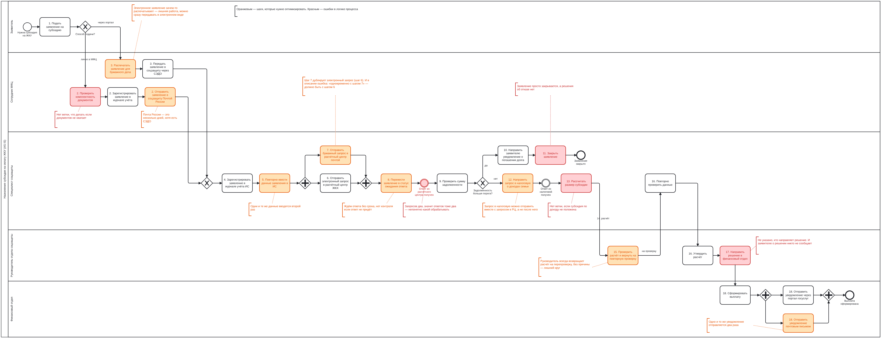
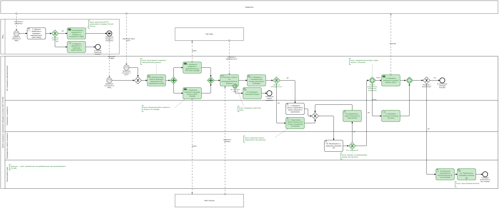

# Housing Subsidy Process: AS IS → TO BE (BPMN 2.0)

**Task:** Model a public service process ("assignment of a housing and utility subsidy") from a text description, find errors and inefficiencies, then redesign it as a TO BE process.
**What I did:** Built the AS IS model (1 pool, 5 lanes) and marked 13 problem steps: 8 inefficiencies (orange) and 5 logic errors (red), each with a comment. Built the TO BE collaboration diagram: the social protection process with 4 lanes, the service center (MFC) as a separate pool, the applicant, the housing information system (GIS ZhKH) and the Federal Tax Service as external participants.
**Tools:** BPMN 2.0, bpmn.io.
**Result:** Every AS IS issue has a fix in TO BE (table below). Paper steps and the duplicate request are gone, the two interagency requests run in parallel instead of one after another, waiting for a response is limited by a 48-hour timer, and the process now ends with an explicit decision: approval with monthly payments for 6 months or a formal refusal.

Documents are in Russian. GitHub does not render `.bpmn`, so PNG previews are included. To open a source file, drag it into [demo.bpmn.io](https://demo.bpmn.io).

## AS IS

Orange: steps to optimize. Red: logic errors.

## TO BE

Green: steps changed or added during redesign. Each green comment shows what it replaced ("Было: …" = "Before: …").

## AS IS problem → TO BE fix

| # | Type | Problem in AS IS | Fix in TO BE |
|---|---|---|---|
| 1 | Inefficiency | Online application is printed to create a paper file | Documents are scanned once and sent electronically (СЭДО) |
| 2 | Inefficiency | Service center sends applications by post | Electronic document exchange (СЭДО) for every application |
| 3 | Inefficiency | Application registered in a journal, then data entered into the system again | Service task: automatic registration, data entered once |
| 4 | Inefficiency | Paper request to the billing center duplicates the electronic one | One electronic request via the interagency exchange system (СМЭВ) |
| 5 | Inefficiency | Waiting for a response with no deadline | Non-interrupting boundary timer: after 48 hours without a response, a repeat request is sent |
| 6 | Inefficiency | Tax service queried only after the debt check | Parallel gateway: debt and income requests sent at the same time |
| 7 | Inefficiency | Manager always returns the calculation for re-check | Gateway "Any remarks?": rework loop only when there are remarks |
| 8 | Inefficiency | Notification always sent twice (portal and post) | Inclusive gateway: channels chosen by the applicant |
| 9 | Logic error | No branch for an incomplete document set | Gateway "Set complete?": documents returned with a list of what is missing, application not accepted |
| 10 | Logic error | Two requests to the billing center give two responses, unclear which one to process | One request per agency, one task receives both responses |
| 11 | Logic error | Application is just "closed" with no refusal decision | Specialist prepares a refusal decision with reasons, signed by the manager |
| 12 | Logic error | No branch for "subsidy not due" | Automatic eligibility check and gateway "Entitled to subsidy?" |
| 13 | Logic error | Unclear who sends the decision to finance; applicant never told the decision | Decision sent to the applicant (message flow); finance department picks up approved decisions in the same process |

One more change beyond the 13 issues: the AS IS ends with a single payment, while TO BE adds the recipient to the payment register for 6 months and pays monthly (loop task).

## BPMN elements used in TO BE

Pools and lanes, black-box pools, message flows; message start and end events, non-interrupting timer boundary event; exclusive, parallel and inclusive gateways; user, manual, service, send and receive tasks, loop task; text annotations.

## Files

| File | Description |
|---|---|
| `as-is/subsidy-as-is.bpmn` | AS IS source (BPMN 2.0 XML) |
| `as-is/subsidy-as-is.png` | AS IS preview |
| `to-be/subsidy-to-be.bpmn` | TO BE source (BPMN 2.0 XML) |
| `to-be/subsidy-to-be.png` | TO BE preview |
