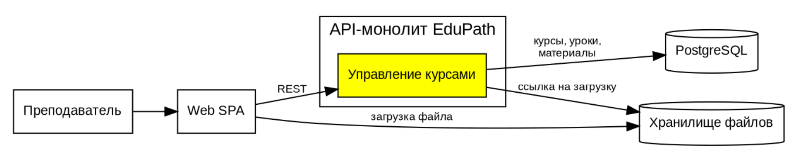

# EduPath: API Design

**Task:** For an online-course platform (EduPath, modular monolith), pick a functional zone and design its API: component diagram, zone description, conceptual API design table, OpenAPI specification.
**What I did:** Designed the "Course management" zone (a teacher creates a course and fills it with lessons and materials): defined boundaries and interactions, drew the component diagram, filled the conceptual design table and wrote the OpenAPI spec. Then wrote a second spec for the "Testing" zone (a student takes the final test).
**Tools:** C4 model, OpenAPI 3.0, Swagger Editor.
**Result:** 2 specifications, 6 endpoints in total. Course creation and lesson creation require an `Idempotency-Key` header against duplicates; materials are uploaded from the browser straight to file storage via a temporary link, so the monolith does not carry file traffic; a repeated test submission returns `409 Conflict`.

Individual work, based on the architecture from a team kata (see [04-edupath-architecture-kata](../04-edupath-architecture-kata/)). Documents are in Russian.

## Component diagram

## Course management — [open in Swagger Editor](https://editor.swagger.io/?url=https://raw.githubusercontent.com/SolodovnikA/business-analysis-portfolio/main/03-edupath-api-design/edupath-course-authoring.yaml)

| Method | Path | Purpose |
|---|---|---|
| POST | `/courses` | Create a course (status DRAFT) |
| POST | `/courses/{courseId}/materials` | Register a material, get a temporary upload link |
| POST | `/courses/{courseId}/lessons` | Add a lesson and attach materials |

## Testing — [open in Swagger Editor](https://editor.swagger.io/?url=https://raw.githubusercontent.com/SolodovnikA/business-analysis-portfolio/main/03-edupath-api-design/edupath-assessment.yaml)

| Method | Path | Purpose |
|---|---|---|
| POST | `/tests/{testId}/attempts` | Start an attempt, get questions without correct answers |
| POST | `/attempts/{attemptId}/submit` | Submit answers, get score and pass/fail |
| GET | `/attempts/{attemptId}/result` | Get the saved result of an attempt |

## Files

| File | Description |
|---|---|
| `api-design.md` | Zone description and conceptual API design table (Russian) |
| `edupath-course-authoring.yaml` | OpenAPI 3.0: course management |
| `edupath-assessment.yaml` | OpenAPI 3.0: testing |
| `c4-components.png` | Component diagram |
