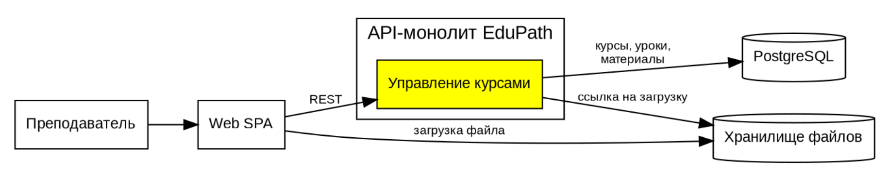

# EduPath — проектирование API модуля «Управление курсами»

## 1. Описание функциональных границ

### 1.1 Диаграмма компонентов

### 1.2 Описание модуля

Архитектура EduPath — модульный монолит, поэтому вместо отдельного микросервиса выбрана функциональная зона — модуль «Управление курсами». Он закрывает бизнес-операции 6 и 7 из архитектурной каты: преподаватель создаёт курс, наполняет его уроками и материалами и создаёт итоговый тест.

Назначение модуля: провести курс от пустого черновика до готового к публикации курса с уроками, материалами и итоговым тестом.

**Взаимодействие**

- Web SPA → модуль: REST API `/api/v1`, авторизация по токену. Методы доступны только преподавателю, изменять курс может только его автор.
- Модуль → хранилище: модуль выдаёт временную ссылку, файл загружается из браузера напрямую в хранилище, не нагружая монолит.

## 2. Концептуальное проектирование API

| Потребители | Цель | Задачи | Входные данные | Выходные данные |
|---|---|---|---|---|
| Web SPA (кабинет преподавателя) | Создать курс | Проверить роль преподавателя и обязательные поля, создать курс в статусе «черновик» | Название, описание, категория | Идентификатор курса, статус |
| Web SPA (кабинет преподавателя) | Загрузить материал урока | Проверить тип и размер файла, зарегистрировать материал, выдать временную ссылку на загрузку в хранилище | Идентификатор курса, имя файла, тип файла, размер | Идентификатор материала, ссылка на загрузку |
| Web SPA (кабинет преподавателя) | Добавить урок в курс | Проверить, что преподаватель — автор курса, определить порядковый номер, сохранить урок и привязать материалы | Идентификатор курса, название урока, порядковый номер, текст урока, идентификаторы материалов | Идентификатор урока, порядковый номер |

## 3. Спецификация

OpenAPI 3.0: [`edupath-course-authoring.yaml`](edupath-course-authoring.yaml)
