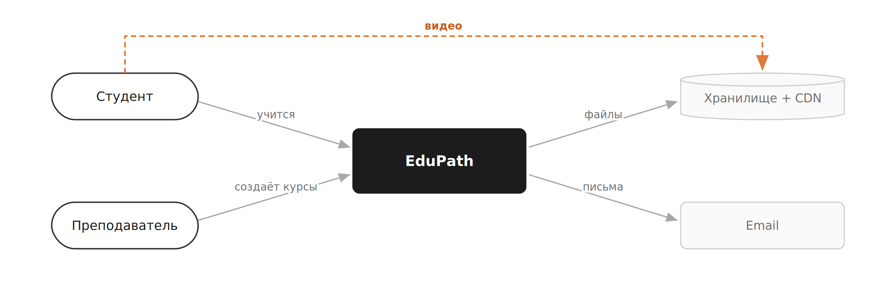

# EduPath: Architecture Kata (team of 6)

**Task:** Choose and justify an architectural style for EduPath, an online-course platform with certification; describe key business operations and C4 diagrams.
**What I did (my part):** Filled the architecture analysis table: assessed the options against 6 criteria (speed of change, team size, legacy and regulatory constraints, SLA, budget and timeline, DevOps maturity). Wrote the justification for the chosen style and the list of 9 key business operations (catalog and enrollment, lessons and progress, test attempts and results, certificates, course and test authoring).
**Tools:** C4 model (context, container), Word.
**Result:** Modular monolith chosen over microservices: a small team with medium DevOps experience can ship an MVP faster, heavy tasks (video delivery, certificate generation) go to a CDN and a background worker, and strict module boundaries keep the option to extract services later. SLA framed around concurrent load and idempotency rather than uptime; legacy reframed as regulatory constraints (personal data law, equal access to content).

Team work of 6 students, published with the team's consent. The C4 context and container diagrams were made by teammates. Documents are in Russian.

## C4 context diagram

## Files

| File | Description |
|---|---|
| `c4-context.png` | C4 context diagram (team) |
