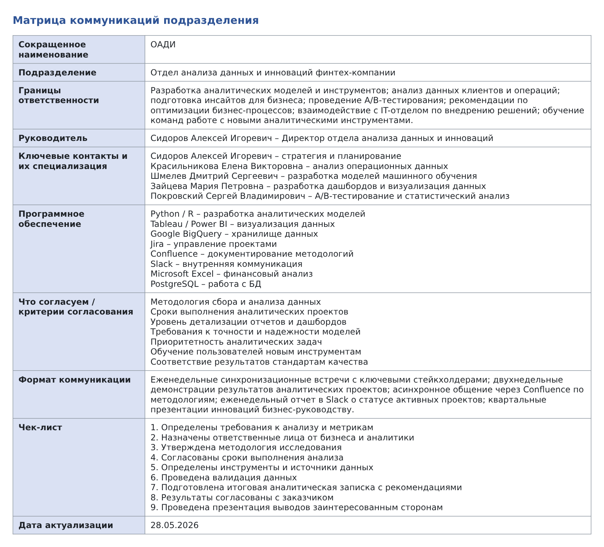

# Communication Matrix: Fictional Fintech Data Department

**Task:** Build a communication matrix for a real or fictional department.
**What I did:** Designed a fictional data analysis and innovation department in a fintech company and filled 10 fields: responsibility boundaries, head and 5 key contacts with their focus, 8 tools, 7 items that need approval, communication formats, a 9-point checklist and an update date.
**Tools:** Excel.
**Result:** One-page matrix a new team member can use to see whom to ask, through which channel and what needs sign-off.

Individual work. The department and all people in it are fictional. Documents are in Russian.

## Preview

## Files

| File | Description |
|---|---|
| `communication-matrix.xlsx` | Matrix (source) |
| `communication-matrix.png` | Preview |
