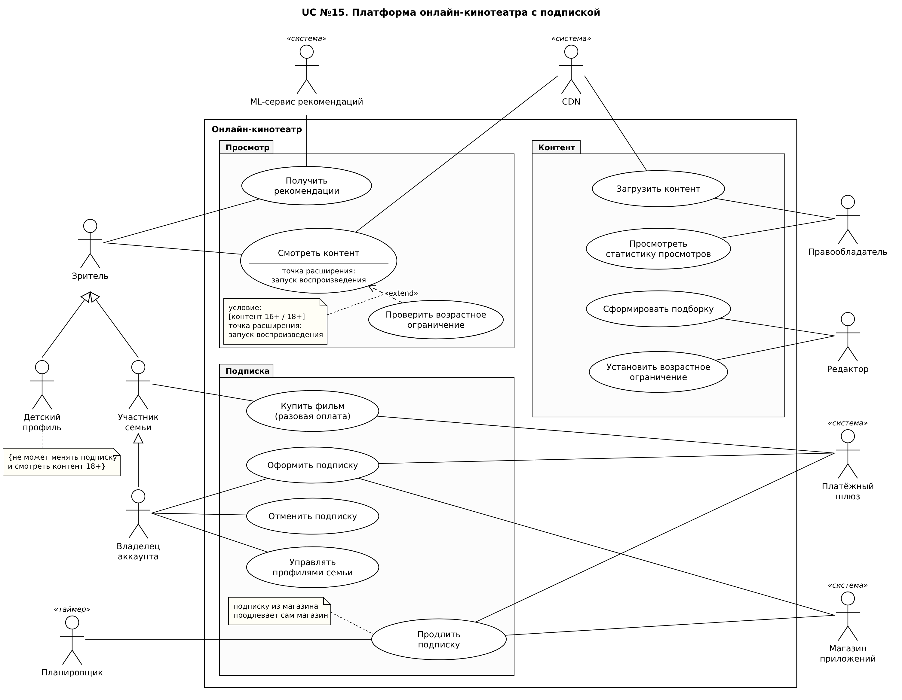
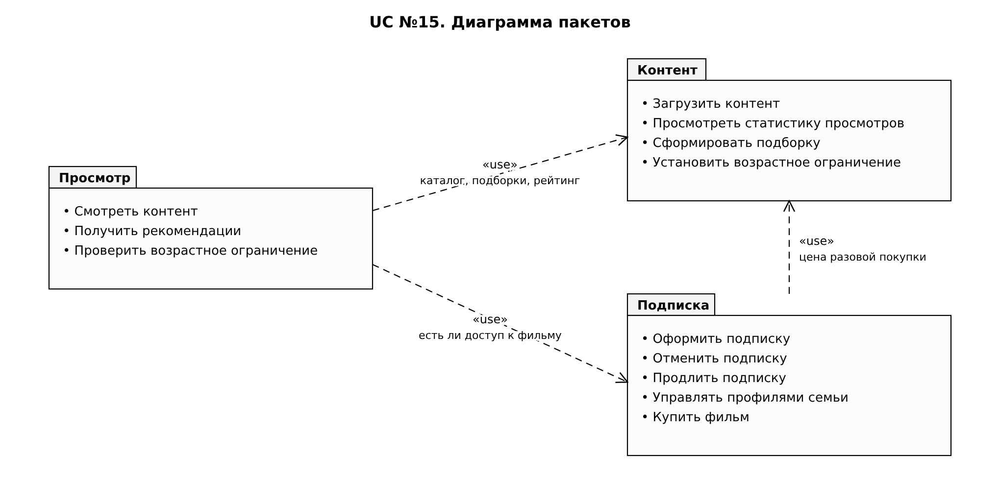
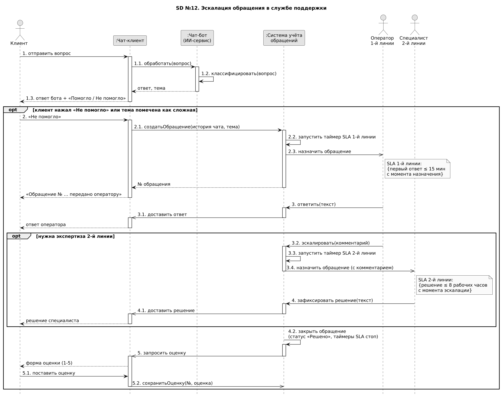
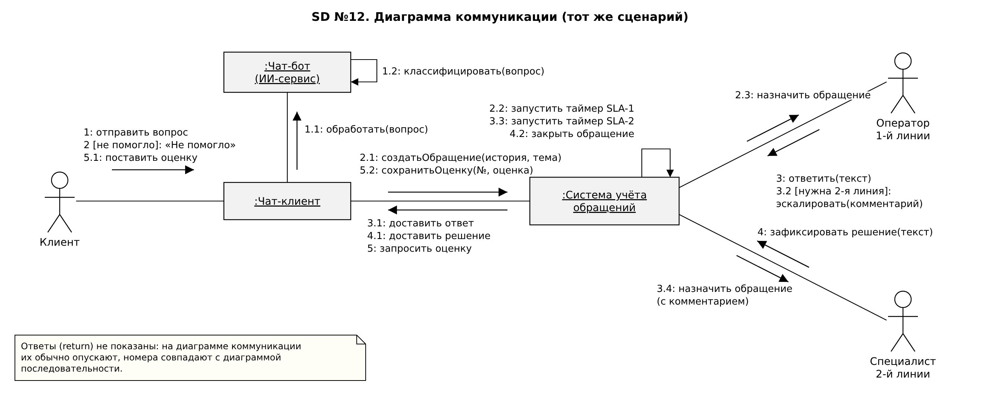

# UML Practicum: Use Case, Package, Sequence and Communication Diagrams

**Task:** From a set of 30 cases, pick one for use case modelling and one for sequence modelling, draw the diagrams in correct UML notation and justify every modelling decision in writing.
**What I did:** Two cases. For an online cinema with subscriptions (UC 15): a use case diagram with a three-level actor hierarchy, a package diagram and a full use case description. For support ticket escalation (SD 12): a sequence diagram with nested `opt` fragments and SLA constraints, plus a communication diagram of the same scenario and a comparison of the two.
**Tools:** UML 2 (use case, package, sequence, communication diagrams), PlantUML, use case template.
**Result:** 4 diagrams and 7 pages of written justification.

Individual work, «IT Business Analysis» course. Documents are in Russian.

## UC 15. Online cinema with subscriptions

- **Actor generalization in three levels:** Viewer → Family member → Account owner. The child profile inherits only from Viewer, so paid actions are unavailable to it by the structure of the diagram itself; the 18+ ban is shown as a constraint.
- **Auto-renewal** is started by a *Scheduler* actor («timer»), not a person. The payment gateway and the app store are separate actors: a subscription bought through App Store / Google Play is renewed by the store, not by our service.
- **`extend` «Check age restriction»** only on «Watch content», with extension point *playback start* and condition [16+ / 18+]. The arrow points from the extending use case to the base one: playback works without the check, and the base use case does not know about it.
- **Package diagram:** Viewing, Subscription and Content with «use» dependencies; Content depends on nothing, so it can change independently.

**Use case description «Subscribe» (payment through an app store):** main flow of 7 steps, alternate flows for an existing web subscription (double charge warning), a cancelled payment and a failed receipt check, pre- and postconditions. See the PDF.

## SD 12. Support ticket escalation

- **Nested `opt` fragments:** the outer one for escalation to the 1st line («Didn't help» or a complex topic), the inner one for the 2nd line. Closing and rating are inside the outer fragment: if the bot helped, there is no ticket to close.
- **Synchronous vs asynchronous messages:** calls inside the system are synchronous; assigning a ticket to a person, delivering answers and asking for a rating are asynchronous, because the system does not wait for a human.
- **SLA** as duration constraints in notes: first response ≤ 15 min, 2nd-line resolution ≤ 8 working hours (the case gave no values, so they are stated as assumptions).
- **Chatbot as a separate lifeline:** it is a separate AI service that other channels can call, and it shows exactly where the bot decides and where people take over.

**Sequence vs communication:** the sequence diagram is easier to read here, because order, escalation conditions and response times matter. The communication diagram adds one thing: it shows that every message goes through the ticket system.

## Files

| File | Description |
|---|---|
| `uc15-online-cinema.pdf` | UC 15: diagrams, justification, use case description (4 pages, Russian) |
| `sd12-support-escalation.pdf` | SD 12: diagrams, justification, comparison table (3 pages, Russian) |
| `*.png` | The four diagrams |
